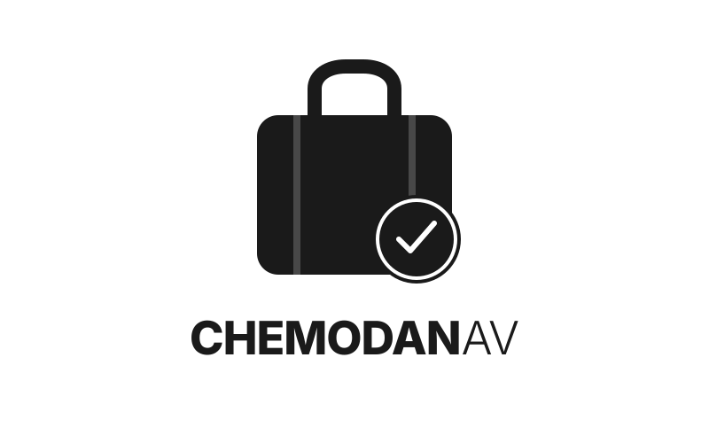

# ChemodanAntiVirus

  

  
  
  
  

**ChemodanAntiVirus** — это агрессивный сканер безопасности с графическим интерфейсом (GUI) на Python, предназначенный для глубокой проверки файлов, поиска вредоносного кода, изоляции угроз и мониторинга системы.

Проект использует сигнатурный анализ по базам MalwareBazaar, проверку по YARA-правилам и собственную поведенческую эвристику.

## Основные возможности

* **Сигнатурный анализ (SHA-256):** Загружает актуальные хэши вредоносных программ напрямую из MalwareBazaar API (требуется Auth-Key).
* **YARA-сканирование:** Автоматически клонирует и использует базу правил `Neo23x0/signature-base` для поиска угроз по паттернам.
* **Поведенческая эвристика:** Встроенная база из 25+ регулярных выражений для выявления:
    * Обфусцированных PowerShell-скриптов (`-enc`, скрытые окна).
    * Попыток отключения защиты (удаление теневых копий, отключение восстановления).
    * Инструментов кражи паролей (`mimikatz`, дамп `lsass`).
    * Скрытых загрузок (`certutil`, `bitsadmin`, `mshta`).
    * Майнеров криптовалют (`stratum+tcp`, `xmrig`).
* **Детектор маскировки:** Выявляет файлы с двойным расширением (например, `invoice.pdf.exe`).
* **Мониторинг процессов:** В реальном времени отслеживает запуск подозрительных процессов (`xmrig`, `mimikatz`, `psexec` и др.).
* **Карантин:** Изолирует опасные файлы, лишая их прав на выполнение (chmod 400), с возможностью восстановления или полного удаления.
* **Тёмный интерфейс:** GUI на Tkinter с вкладками результатов, карантина и подробного журнала.

## Установка и запуск

### 1. Требования
Убедитесь, что у вас установлены:
* [Python 3.10+](https://www.python.org/downloads/)
* [Git](https://git-scm.com/downloads) (необходим для скачивания YARA-правил при первом запуске).

### 2. Установка зависимостей
Откройте командную строку (cmd) или терминал в папке с проектом (`ChemodanAntiVirus`) и выполните:

pip install -r requirements.txt

### 3. Настройка API (MalwareBazaar)
Для загрузки актуальных хэшей необходим бесплатный API-ключ (Auth-Key).
1. Зарегистрируйтесь на [auth.abuse.ch](https://auth.abuse.ch/).
2. Скопируйте ваш **Auth-Key**.
3. Вставьте его в файл `config.json` в поле `"malwarebazaar_auth_key"`.

*(Альтернатива: задайте переменную окружения `MALWAREBAZAAR_AUTH_KEY` перед запуском).*

### 4. Запуск
Запустите программу из командной строки:

python main.py

> **Примечание:** При первом запуске программа может занять некоторое время для скачивания базы хэшей и клонирования репозитория YARA-правил (папка `data/yara_rules/signature-base`).

## Как пользоваться

1. Нажмите **«Выбрать папку»** или **«Выбрать файл»**, чтобы указать цель для проверки.
2. Нажмите **«Сканировать»**. Прогресс-бар покажет текущий файл.
3. Если найден `MALWARE` и включена галочка **«Авто-карантин MALWARE»**, файл будет автоматически перемещён в изолятор.
4. Все результаты (с указанием причин и начисленных баллов) отображаются на вкладке **«Результаты»**.
5. На вкладке **«Карантин»** можно просмотреть изолированные файлы, восстановить их на место (кнопка «Восстановить») или удалить навсегда.
6. Кнопка **«Обновить базу»** принудительно обновляет хэши из MalwareBazaar, не дожидаясь истечения кэша (6 часов).

## Важная информация

* **Это не замена коммерческому антивирусу.** ChemodanAntiVirus — это инструмент для ручного анализа, проверки скачанных файлов и демонстрации работы эвристик. Он не имеет драйверов для перехвата Zero-Day атак в реальном времени, как у Kaspersky или ESET.
* **Не сканируйте папку `C:\Windows` целиком.** Из-за работы YARA и чтения файлов сканирование системных директорий может занять очень много времени.
* **Ложные срабатывания.** Агрессивная эвристика (порог `MALWARE` = 12 баллов) может иногда помечать в карантин безопасные, но подозрительные скрипты (например, легальные системные утилиты администрирования). Всегда проверяйте причину, указанную в столбце "Причина".
* **Безопасность.** Никогда не запускайте файлы из карантина, если не уверены в их безопасности. Сам сканер только читает файлы и вычисляет хэши, что абсолютно безопасно.

## Структура проекта

ChemodanAntiVirus/
├── main.py              # Графический интерфейс (GUI)
├── scanner.py           # Движок сканирования (хэши, YARA, эвристика)
├── signature_db.py      # Работа с MalwareBazaar API, кэшем и YARA-правилами
├── signatures.py        # База эвристических правил (регулярные выражения)
├── quarantine.py        # Управление карантином (изоляция и восстановление)
├── monitor.py           # Мониторинг запущенных процессов
├── config.json          # Файл конфигурации (пороги, пути, API-ключи)
├── requirements.txt     # Список зависимостей
├── data/                # (Создаётся автоматически) Кэш хэшей и YARA
└── quarantine/          # (Создаётся автоматически) Хранилище опасных файлов

## Для разработчиков (как это работает под капотом)

* **Оценка (Score):** Каждое срабатывание эвристики имеет вес от 1 до 10. Совпадение с базой хэшей даёт мгновенный вердикт `MALWARE` (Score 100). Срабатывание YARA даёт +10 баллов.
* **Пороги вердиктов:** 
    * `Score >= 12` -> **MALWARE** (Авто-карантин)
    * `Score 6-11` -> **SUSPICIOUS** (Требует внимания)
    * `Score < 6` -> **CLEAN** (Чисто)
* **Кэширование:** Хэши хранятся в `data/hashes.json` и обновляются раз в 6 часов, чтобы не превышать лимиты API MalwareBazaar.

---
*Проект создан в образовательных и практических целях.*
